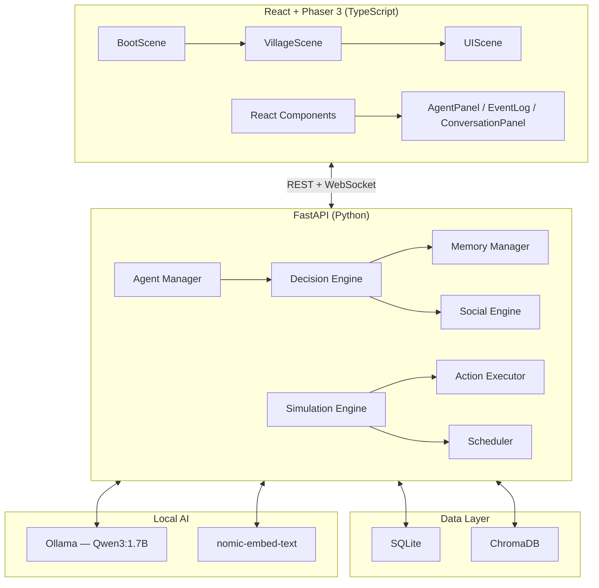
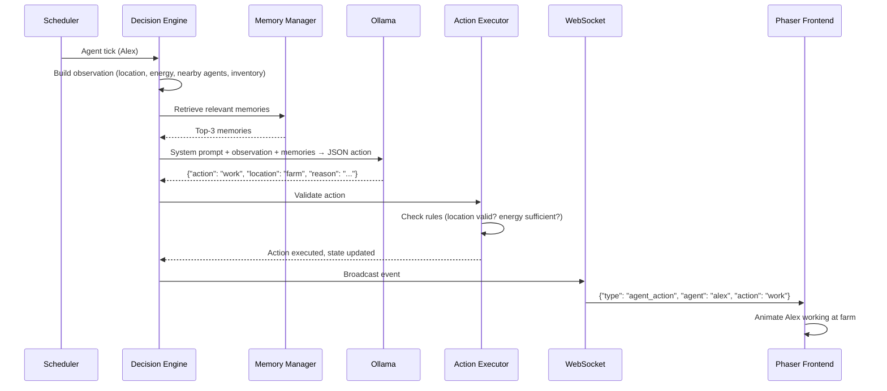
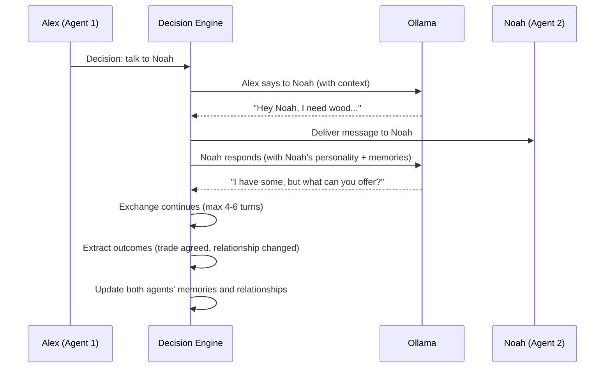
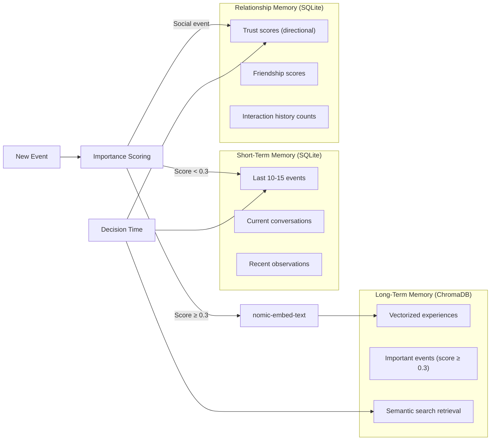
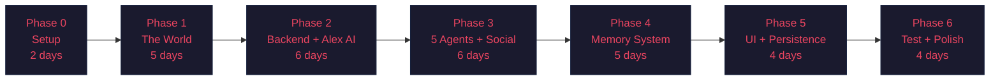

# 🏘️ Tiny Society — Complete Phased Implementation Plan

_Five autonomous minds. One tiny world. Unlimited possibilities._

> [!NOTE]
> This plan breaks the Tiny Society project into **6 phases** across ~5 weeks. Each phase has clear deliverables, milestones, and a "done when" gate so you know exactly when to move on.

---

## Architecture Overview



---

## Phase 0 — Environment & Foundation Setup
**Duration:** 2 days | **Risk:** Low

### Goals
Get every tool installed, repos initialized, and a "hello world" running for each layer.

### Tasks

| # | Task | Details |
|---|------|---------|
| 0.1 | **Initialize monorepo** | Create `tiny-society/` with `frontend/`, `backend/`, `docs/`, `.gitignore`, `README.md` |
| 0.2 | **Frontend scaffolding** | `npm create vite@latest frontend -- --template react-ts` → install Phaser 3 |
| 0.3 | **Backend scaffolding** | `py -m venv venv` → pip install `fastapi uvicorn ollama sqlalchemy pydantic` |
| 0.4 | **Ollama setup** | Install Ollama → `ollama pull qwen3:1.7b` → `ollama pull nomic-embed-text` → verify inference |
| 0.5 | **Git init & first commit** | `.gitignore` for `node_modules/`, `venv/`, `__pycache__/`, `*.db` → initial commit |
| 0.6 | **Dev scripts** | Add `package.json` scripts for frontend dev, backend `uvicorn` startup, concurrent runner |
| 0.7 | **Verify end-to-end** | Frontend Vite page loads → FastAPI `/health` returns 200 → Ollama responds to test prompt |

### Milestone Gate
✅ Vite dev server running · ✅ FastAPI `/health` responding · ✅ Ollama generating text locally

---

## Phase 1 — The World (Static Village)
**Duration:** 5 days | **Risk:** Low–Medium

### Goals
Build the pixel-art village with a walkable map, five characters, collision, camera controls, and a basic React shell.

> [!TIP]
> **Visual Engine Option — 2D Phaser 3 vs. 3D Diorama (Three.js):**
> - **Track A (Default 2D):** React + Phaser 3 with top-down tilemaps (Stardew Valley style).
> - **Track B (3D Diorama Upgrade):** Use the installed `diorama` skill (Three.js with `pixel` or `pixel-stroke` shader preset) to render the village as an interactive, rotatable 3D miniature diorama on a floating ground slab.
> - Regardless of 2D or 3D, adopt Diorama's **5-Layer Animation Grammar** (Idle → Locomotion → Secondary → Glance/Shift → Scripted Acting) and **Action Clearance** to prevent clipping.

### Tasks

| # | Task | Details |
|---|------|---------|
| 1.1 | **Create/acquire tileset / models** | 2D: 16×16 pixel-art tiles (grass, paths, water, fences, trees) OR 3D Diorama: low-poly/voxel models with 64-color palette snap |
| 1.2 | **Design village layout** | 2D: Tiled Map Editor (`village.json`) OR 3D: Diorama scene slab (`DESIGN.md`, ground bounds, building parcels) |
| 1.3 | **Build `BootScene.ts` / Asset Loader** | Preload sprites, tilesets, or 3D models with texture atlases |
| 1.4 | **Build `VillageScene.ts` / Scene Core** | Load map/slab, set world bounds, configure camera (pan/zoom or Diorama orbit) |
| 1.5 | **Create `Character.ts` entity** | Entity class with 5-layer animations (idle, walk, actions), position, name label |
| 1.6 | **Place 5 characters** | Spawn Alex (farm), Mia (town square), Noah (shop), Emma (home), Leo (near buildings) |
| 1.7 | **Implement `MovementSystem.ts`** | Pathfinding (navmesh or grid A*) with Diorama-style action clearance to avoid overlaps |
| 1.8 | **Collision & clearance layer** | Characters collide with buildings, water, map edges; parcel boundaries respected |
| 1.9 | **Build `App.tsx` shell** | React wrapper embedding game canvas + placeholder side panels |
| 1.10 | **Camera & zoom** | Pan/zoom or rotatable 3D orbit controls (`templates/orbit.js`); follow selected character |
| 1.11 | **4 buildings** | Place Farm, Shop, Community Hall, Town Square with defined entry points |
| 1.12 | **5 houses** | Place individual homes for each agent with spawn points |

### Milestone Gate
✅ Five pixel-art characters walk around the village independently · ✅ Collision & clearance work · ✅ Map renders correctly with buildings

### Deliverables
- `frontend/public/maps/village.json`
- `frontend/public/assets/characters/` (5 sprite sheets)
- `frontend/public/assets/buildings/`, `tilesets/`, `environment/`
- `frontend/src/game/scenes/{BootScene, VillageScene, UIScene}.ts`
- `frontend/src/game/entities/Character.ts`
- `frontend/src/game/systems/MovementSystem.ts`

---

## Phase 2 — Backend Core & Single Agent AI Loop
**Duration:** 6 days | **Risk:** Medium (this is the hardest phase)

### Goals
Build the entire FastAPI backend, implement the agent decision loop for ONE agent (Alex), connect it to Ollama, and make Alex autonomously decide and act in the frontend.

> [!IMPORTANT]
> Build everything for Alex first. Debug one agent completely before scaling to five. This prevents you from debugging five different problems simultaneously.

### Tasks

| # | Task | Details |
|---|------|---------|
| 2.1 | **`config.py`** | Centralized settings: Ollama URL, model name, DB path, simulation speed, tick interval |
| 2.2 | **`database/models.py`** | SQLAlchemy models: `Agent`, `AgentState`, `Relationship`, `Event`, `Conversation`, `WorldState` |
| 2.3 | **`database/repository.py`** | CRUD operations for all models; SQLite file-based DB |
| 2.4 | **`agents/agent.py`** | `Agent` class: name, personality, occupation, goals, energy, happiness, location, inventory, memories, relationships |
| 2.5 | **`agents/personalities.py`** | 5 personality profiles as structured dicts (start with Alex only) |
| 2.6 | **`agents/agent_manager.py`** | Initialize agents, load/save state, get agent by name, update agent state |
| 2.7 | **`llm/ollama_client.py`** | Async Ollama wrapper: `generate_decision()`, `generate_dialogue()`, `generate_embedding()` using structured JSON output |
| 2.8 | **`llm/prompts.py`** | System prompt templates per agent, observation formatter, decision prompt, conversation prompt |
| 2.9 | **`agents/decision_engine.py`** | **The core loop:** Observe → Retrieve memories → Think (Ollama call) → Validate → Return structured action |
| 2.10 | **Action schema** | JSON Schema for structured output: `action` (enum), `target`, `location`, `reason`, `dialogue` |
| 2.11 | **`simulation/world.py`** | World state: time of day, locations, resources, weather; query methods |
| 2.12 | **`simulation/action_executor.py`** | Validate and execute actions: move (check destination exists), work (update resources), rest (restore energy), idle |
| 2.13 | **`simulation/scheduler.py`** | Event-driven tick system: every N seconds, advance sim time, trigger decisions for agents whose "cooldown" expired |
| 2.14 | **`simulation/engine.py`** | Main simulation loop: tick world → for each agent → decision → validate → execute → broadcast |
| 2.15 | **`api/simulation.py`** | REST endpoints: `POST /simulation/start`, `/pause`, `/reset`, `/speed` |
| 2.16 | **`api/agents.py`** | REST endpoints: `GET /agents`, `GET /agents/{id}`, `GET /agents/{id}/memories`, `GET /agents/{id}/relationships` |
| 2.17 | **`api/websocket.py`** | WebSocket `/ws/simulation` broadcasting: `agent_action`, `agent_moved`, `agent_spoke`, `world_tick` |
| 2.18 | **`main.py`** | FastAPI app with CORS, lifespan events, route includes |
| 2.19 | **Frontend WebSocket client** | `services/websocket.ts` connecting to backend WS, dispatching events to Phaser |
| 2.20 | **Frontend REST client** | `services/api.ts` for simulation controls and agent queries |
| 2.21 | **Connect Alex** | Alex's decisions flow: Backend decides → WS event → Phaser animates Alex walking/working |
| 2.22 | **`useSimulation.ts` hook** | React hook managing connection state, simulation status, agent list |

### Decision Loop (Visual)



### Milestone Gate
✅ Alex independently decides to move, work, and rest · ✅ His actions appear in the Phaser world · ✅ Decisions come from Ollama, not hardcoded

---

## Phase 3 — Five Agents, Conversations & Social System
**Duration:** 6 days | **Risk:** Medium

### Goals
Scale from 1 agent to 5, add agent-to-agent conversations, implement the social/relationship engine, and add user-to-agent interaction.

### Tasks

| # | Task | Details |
|---|------|---------|
| 3.1 | **Activate all 5 personalities** | Add Mia, Noah, Emma, Leo profiles to `personalities.py` |
| 3.2 | **Stagger agent ticks** | Don't call Ollama for all 5 at once — round-robin or stagger by 2–3 seconds |
| 3.3 | **`social/conversation.py`** | Two-stage conversation: initiation → response. Max 4–6 exchanges. One conversation per agent at a time |
| 3.4 | **Conversation prompt** | Include: speaker's personality, listener's personality, relevant memories, relationship state, current goals |
| 3.5 | **`social/relationship_manager.py`** | Directional trust + friendship scores. Update after conversations/trades/conflicts |
| 3.6 | **`talk` action handler** | When agent chooses `talk` → find target → initiate conversation → generate exchanges → update relationship |
| 3.7 | **`trade` action handler** | Resource exchange: validate both parties have items → execute swap → record event |
| 3.8 | **`help` action handler** | Agent assists another's goal: validate context → execute → boost relationship |
| 3.9 | **Conversation UI (frontend)** | `ConversationPanel.tsx`: speech bubbles appear over characters, conversation log in side panel |
| 3.10 | **User interaction endpoint** | `POST /agents/{id}/interact` — user clicks agent, types message, agent responds in-character using memories |
| 3.11 | **Talking indicator** | Phaser speech bubble / icon above characters who are conversing |
| 3.12 | **Activity indicator** | Icon above characters showing current action (🔨 working, 💤 resting, 🗣️ talking) |
| 3.13 | **Emotion indicator** | Optional face/icon reflecting happiness level |

### Conversation Flow



### Milestone Gate
✅ All 5 agents make independent decisions · ✅ Agents talk to each other with personality-consistent dialogue · ✅ Relationships change after interactions · ✅ User can click an agent and chat

---

## Phase 4 — Memory Architecture
**Duration:** 5 days | **Risk:** Medium

### Goals
Implement the three-tier memory system: short-term (recent), long-term (ChromaDB semantic), and relationship memory.

### Tasks

| # | Task | Details |
|---|------|---------|
| 4.1 | **`memory/memory_manager.py`** | Central memory API: `add_memory()`, `get_recent()`, `search_relevant()`, `score_importance()` |
| 4.2 | **Short-term memory** | Rolling buffer of last 10–15 events per agent. Stored in SQLite `Events` table |
| 4.3 | **Memory importance scoring** | After each event, score 0.0–1.0 (e.g., trade = 0.85, idle = 0.1). Only store events ≥ 0.3 as long-term |
| 4.4 | **Install ChromaDB** | `pip install chromadb` → create `agent_memories` collection |
| 4.5 | **`memory/embedding_service.py`** | Call `ollama.embeddings(model='nomic-embed-text', prompt=...)` to vectorize memory text |
| 4.6 | **`memory/retrieval.py`** | Semantic search: given current situation, retrieve top-3 relevant past memories from ChromaDB |
| 4.7 | **Memory metadata** | Store: `agent_id`, `event_type`, `related_agent`, `importance`, `simulation_day`, `location` |
| 4.8 | **Wire memories into decisions** | Before each Ollama decision call, retrieve relevant memories and inject them into the prompt |
| 4.9 | **Relationship memory integration** | Decision prompt includes current trust/friendship scores for nearby agents |
| 4.10 | **Memory decay (optional)** | Reduce importance of very old memories unless they were very significant |
| 4.11 | **Promise tracking** | When agents make promises ("bring vegetables tomorrow"), store as special memory with a fulfillment deadline |

### Memory Architecture



### Milestone Gate
✅ Agents reference past events in their decisions · ✅ Semantic memory retrieval returns relevant (not random) memories · ✅ Relationship scores visibly influence behavior (Noah more willing to trade with high-trust agents)

---

## Phase 5 — UI, Persistence & Controls
**Duration:** 4 days | **Risk:** Low

### Goals
Build the full dashboard UI, add save/load persistence, simulation controls, and the polished user experience.

### Tasks

| # | Task | Details |
|---|------|---------|
| 5.1 | **`AgentPanel.tsx`** | Click a character → side panel shows: name, occupation, personality, current goal, energy, happiness, inventory |
| 5.2 | **`RelationshipPanel.tsx`** | Visual relationship map: trust/friendship bars between selected agent and others |
| 5.3 | **`EventLog.tsx`** | Scrolling live feed: "10:25 · Alex started working at the farm", "10:27 · Mia approached Alex" |
| 5.4 | **`WorldControls.tsx`** | Pause / Resume / Speed (1×, 2×, 5×) / Save / Reset buttons |
| 5.5 | **`ConversationPanel.tsx`** | Live conversation view with character portraits and speech text |
| 5.6 | **Dark theme** | Consistent dark-themed UI matching the mockup (dark backgrounds, green accents, card-based layout) |
| 5.7 | **Persistence — Save** | On save: dump all agent states, relationships, world time, memories, events to SQLite |
| 5.8 | **Persistence — Load** | On app start: detect existing save → restore everything → continue simulation from last state |
| 5.9 | **Auto-save** | Every N simulation minutes, auto-save to prevent data loss |
| 5.10 | **Reset** | Clear all state, reinitialize agents to defaults, reset world time to Day 1 Morning |
| 5.11 | **Minimap** | Small corner minimap showing character positions on the full village |
| 5.12 | **Time display** | Show current simulation time: "Day 3 · 14:30 · Afternoon" |

### UI Layout

```
┌──────────────────────────────────────────────────────────┐
│  ⏸ Pause   ⏩ Speed    💾 Save    │ Day 2 · 10:25 AM    │
├──────────────────────────────┬───────────────────────────┤
│                              │  👤 Alex — Farmer         │
│                              │  Energy: ████████░░ 80%   │
│      Phaser Village          │  Happiness: ██████░░ 70%  │
│      (2D Pixel World)        │  Action: Working at farm  │
│                              │  Goal: Collect food        │
│                              ├───────────────────────────┤
│                              │  📜 Event Log              │
│                              │  10:25 Alex → farm         │
│                              │  10:27 Mia → town square   │
│                              │  10:29 Noah opened shop     │
├──────────────────────────────┴───────────────────────────┤
│  [Alex] [Mia] [Noah] [Emma] [Leo]  — 5 agents active    │
└──────────────────────────────────────────────────────────┘
```

### Milestone Gate
✅ Full dashboard with agent panels, event log, controls · ✅ Save and reload simulation state perfectly · ✅ Speed controls work · ✅ User can click any agent and see their profile

---

## Phase 6 — Testing, Optimization & Polish
**Duration:** 4 days | **Risk:** Low

### Goals
Test emergent behavior, optimize Ollama inference, add evaluation metrics, and prepare for demo.

### Tasks

| # | Task | Details |
|---|------|---------|
| 6.1 | **Backend unit tests** | pytest: test decision engine, action validation, memory scoring, relationship updates |
| 6.2 | **Integration tests** | Test full loop: agent tick → Ollama call → action executed → state updated |
| 6.3 | **Scenario tests** | 20–30 controlled scenarios from the plan's test table |
| 6.4 | **Personality consistency test** | Run same scenario with different agents → verify different responses matching personality |
| 6.5 | **Memory retrieval relevance test** | Inject known memories → verify the right ones are retrieved for a given situation |
| 6.6 | **Ollama optimization** | Tune `num_ctx`, `temperature`, `top_p`; measure tokens/sec; optimize prompt length |
| 6.7 | **Inference batching** | Stagger agent calls to avoid GPU contention; profile latency per agent |
| 6.8 | **Evaluation metrics** | Log: action validity %, memory retrieval relevance, goal completion rate, conversation coherence |
| 6.9 | **Behavior experiment** | Compare Noah's willingness to help Alex before/after building friendship — document emergent behavior |
| 6.10 | **README & documentation** | `README.md` with screenshots, setup guide, architecture overview, demo instructions |
| 6.11 | **Demo recording** | Record 3–5 minute video showing autonomous village life, conversations, memory-driven decisions |
| 6.12 | **Final QA & Visual Regression** | Test save/load, reset, edge cases, and run visual motion/teleport checks (leveraging `diorama/templates/qa` scripts like `frames.mjs` and `freeze(t)`) |

### Test Scenarios Table

| # | Scenario | Expected Outcome |
|---|----------|-----------------|
| T1 | Alex needs wood, Leo has it | Alex seeks Leo or Noah for wood |
| T2 | Noah refuses a trade | Alex remembers the refusal next time |
| T3 | Mia meets Emma | They initiate a personality-consistent conversation |
| T4 | Leo receives a help request | He evaluates it against "prefers working alone" |
| T5 | Simulation save → restart | All states, memories, relationships persist |
| T6 | User talks to Noah about refusal | Noah explains reasoning using actual memory |
| T7 | Emma notices unhappy agent | She approaches them to help (caretaker personality) |
| T8 | High friendship pair | More likely to help each other |
| T9 | Broken promise detected | Trust score decreases |
| T10 | Day cycle completes | Agents rest at night, resume in morning |

### Milestone Gate
✅ All test scenarios pass · ✅ Metrics show >90% action validity · ✅ Emergent behavior documented · ✅ README complete · ✅ Demo video recorded

---

## Complete Timeline Summary



| Phase | Duration | Cumulative | Key Deliverable |
|-------|----------|-----------|-----------------|
| **Phase 0** — Setup | 2 days | Day 2 | Dev environment ready |
| **Phase 1** — The World | 5 days | Day 7 | Pixel-art village with walking characters |
| **Phase 2** — Backend + Alex | 6 days | Day 13 | One agent making AI-driven decisions |
| **Phase 3** — Five Agents + Social | 6 days | Day 19 | All agents conversing and interacting |
| **Phase 4** — Memory | 5 days | Day 24 | Three-tier memory influencing behavior |
| **Phase 5** — UI + Persistence | 4 days | Day 28 | Polished dashboard, save/load |
| **Phase 6** — Testing + Polish | 4 days | Day 32 | Tested, documented, demo-ready |

> [!TIP]
> **Total: ~32 working days (~5 weeks).** Adjust pace around academic work. The phases are designed so each one produces a working, demoable state — you never have a broken project between phases.

---

## Tech Stack Summary

| Layer | Technology | Purpose |
|-------|-----------|---------|
| Frontend Framework | React + TypeScript | UI shell, panels, controls |
| Game / World Engine | Phaser 3 (2D Tilemap) *or* Three.js (Diorama 3D Miniature) | Village world rendering, sprites/models, animation |
| Backend Framework | FastAPI (Python) | API, simulation orchestration, agent management |
| LLM Runtime | Ollama (local) | AI decisions and conversations |
| Chat Model | Qwen3:1.7B | Agent decision-making and dialogue |
| Embedding Model | nomic-embed-text | Memory vectorization for semantic search |
| Vector DB | ChromaDB | Long-term semantic memory retrieval |
| Relational DB | SQLite | Persistent state, relationships, events |
| Communication | REST + WebSocket | Config/queries + live simulation events |
| Map Editor | Tiled | Village tilemap design |

---

## Risk Register

| Risk | Impact | Mitigation |
|------|--------|-----------|
| Ollama too slow on T550 GPU | Agents lag behind real-time | Stagger decisions, reduce prompt length, lower `num_ctx` |
| Qwen3:1.7B produces invalid JSON | Actions fail validation | Use structured output `format` param; fallback to `idle` on parse error |
| 5 concurrent agent prompts | GPU out of memory | Sequential agent ticks (round-robin), never parallel |
| ChromaDB adds complexity too early | Debug nightmare | Start with SQLite-only memory; add ChromaDB in Phase 4 only |
| Phaser tilemap rendering issues | Map doesn't look right | Test tilemap export from Tiled early in Phase 1 |
| Scope creep | Never finishes | Strict phase gates — no Phase N+1 work until Phase N milestone passes |
