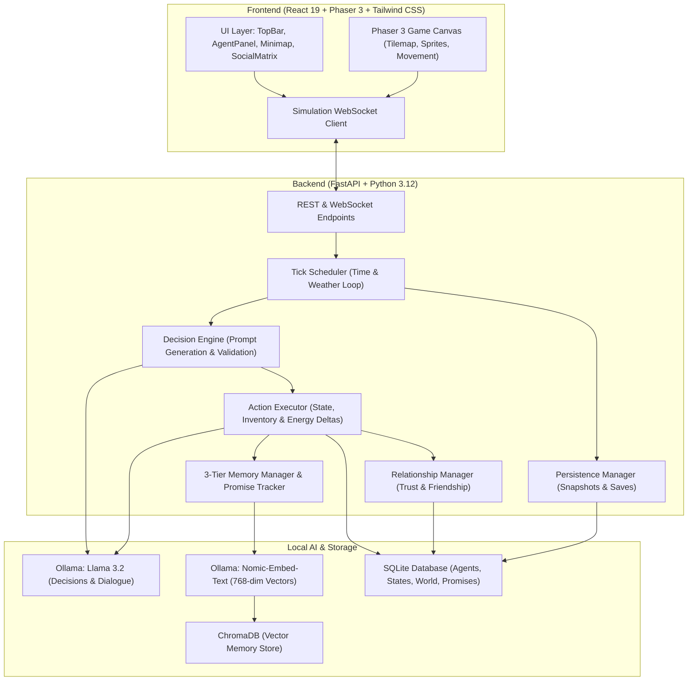

# 🏘️ Tiny Society — Autonomous AI Village Simulation

_Five autonomous minds. One living 2D pixel-art world. Emergent social dynamics._

Tiny Society is an autonomous agent simulation where 5 AI characters live in an interactive 2D pixel-art village. Powered entirely by local GPU-accelerated LLM inference (**Ollama with Llama 3.2** and **Nomic Embed Text** via **ChromaDB**), characters make autonomous decisions, conduct multi-turn conversations, manage occupations and inventories, form evolving relationships, and retain memories across days.

---

## 🌟 Key Features

- **🧠 Autonomous Agent Minds:** Five distinct agents with rich personalities, goals, internal tensions, and daily routines running on local `llama3.2`.
- **💬 Dynamic Multi-Turn Conversations:** Natural spoken dialogue when villagers meet or are manually triggered, complete with floating speech bubbles and dialogue cards.
- **📚 3-Tier Cognitive Memory System:**
  1. *Tier 1: Recency Buffer* — Instant chronological recall of immediate actions and conversations.
  2. *Tier 2: Importance Scorer* — Heuristic evaluation scoring memories based on event severity, social impact, and keywords (e.g. deals, debts, promises).
  3. *Tier 3: Semantic Vector Search* — High-importance memories (score ≥ 0.3) embedded with `nomic-embed-text` (768 dimensions) into a persistent ChromaDB vector store and retrieved via cosine similarity during decision-making.
- **🤝 Promise & Commitment Tracking:** Active detection of commitments made in dialogue (e.g., *"I will bring you 5 sacks of wheat tomorrow"*), assigned deadlines, and fulfillment validation.
- **❤️ Social Network & 5x5 Relationship Matrix:** Directional trust and friendship meters ($A \to B$ and $B \to A$), reciprocal adjustments, and interaction logs.
- **📡 Village Radar Minimap:** Live scalable 2D minimap showing world coordinates, landmark icons, and real-time agent blips with focus-click navigation.
- **💾 Full Persistence & State Snapshots:** Complete simulation state (agents, energy, inventories, relationships, promises, world time) saved to and restored from persistent JSON snapshots, with automatic 30-tick background auto-saves.
- **🎮 Interactive 2D Pixel-Art World:** Built in Phaser 3 with smooth A* pathfinding, camera zoom/pan, landmark inspection, and direct chat intervention.

---

## 🗺️ Village Overview & Locations

Rendered on a 1280×1280 top-down pixel-art tilemap:
- **🌾 Alex's Farm & Barn:** Large red barn, cattle pasture, hay bales, and golden wheat fields.
- **🍞 Mia's Bakery & Cottage:** Stone cottage with chimney smoke, baking hearth, and pastry display.
- **🪙 Noah's General Store:** Merchant trading post with open awnings and fresh water well.
- **🌿 Emma's Apothecary Clinic:** Thatched cottage with water lily pond and medicinal herb garden.
- **🪵 Leo's Carpentry Workshop:** Timber framing workbench with open lean-to and lumber stacks.
- **⛲ Town Square & Fountain:** Central cobblestone gathering plaza with a bubbling stone water fountain.
- **⛵ Lake Dock & Campsite:** Reeds, rowboat pier, and traveler campsite for peaceful reflection.

---

## 👥 The 5 Autonomous Villagers

| Villager | Occupation | Personality | Key Goal | Core Conflict / Tension | Home & Work |
|---|---|---|---|---|---|
| **Alex** | Farmer 🌾 | Diligent, humble, optimistic | Grow bountiful harvests for all villagers | Anxious about erratic weather and grain shortages | Farmhouse & Wheat Field |
| **Mia** | Baker 🥖 | Warm, cheerful, talkative | Master artisan pastries and bring people together | Struggles with fluctuating ingredient supply | Cottage & Bakery |
| **Noah** | Merchant 🛒 | Cautious, shrewd, analytical | Build a thriving, resilient trading enterprise | Torn between village generosity and profit margins | Storehouse & Shop |
| **Emma** | Healer 🌿 | Empathetic, observant, patient | Ensure wellness and discover rare remedies | Worried about villagers neglecting health for work | Apothecary & Lake Herbs |
| **Leo** | Carpenter 🔨 | Creative, quiet, introspective | Construct enduring, beautiful wooden structures | Frustrated when quality craftsmanship is rushed | Quarters & Workshop |

---

## 🚀 Quick Start Guide

### 1. Prerequisites
- **Node.js:** v18+ (tested on v20 and v24)
- **Python:** 3.10+ (tested on Python 3.12)
- **Ollama:** Installed and running locally with `llama3.2` and `nomic-embed-text`:
  ```bash
  ollama pull llama3.2
  ollama pull nomic-embed-text
  ```

### 2. Unified One-Command Runner

Launch the full stack (FastAPI backend + Vite React/Phaser frontend) with unified logs:

```bash
# Option A: Python Runner (Cross-platform)
python run.py

# Option B: Windows Batch
run.bat

# Option C: PowerShell
.\run.ps1
```

Both services will start simultaneously:
- **Frontend Dashboard:** [http://localhost:5173](http://localhost:5173)
- **Backend API & Swagger Docs:** [http://localhost:8000/docs](http://localhost:8000/docs)
- **WebSocket Endpoint:** `ws://localhost:8000/ws/simulation`

---

### 3. Manual Step-by-Step Setup

#### Backend Setup
```bash
cd backend
python -m venv venv

# Windows
.\venv\Scripts\activate

# macOS / Linux
source venv/bin/activate

pip install -r requirements.txt
uvicorn app.main:app --reload --port 8000
```

#### Frontend Setup
```bash
cd frontend
npm install
npm run dev
```

---

## 🧪 Automated Testing & Verification

The project includes an end-to-end automated test suite built with `pytest` and `pytest-asyncio` covering all simulation logic, decisions, memory scoring, vector retrieval, and snapshot persistence.

```bash
cd backend
.\venv\Scripts\activate
pytest backend/tests -v
```

### Test Suite Coverage (25 Automated Tests):
- `backend/tests/test_decisions.py`:
  - Low-energy emergency rule forcing rest at home.
  - JSON schema extraction, regex sanitization, and fallback recovery.
  - Contextual fallback generation for all 5 unique agent personas.
  - System and observation prompt formatting.
- `backend/tests/test_action_executor.py`:
  - Work action inventory generation (Alex: wheat/food, Noah: coins, Leo: wood).
  - Rest action energy and happiness recovery.
  - Movement energy burn and coordinate validation.
- `backend/tests/test_memory_chroma.py`:
  - Importance scoring formula and base weight hierarchy.
  - Social interaction and high-impact keyword multiplier bonuses.
  - Semantic vector normalization and bounding.
- `backend/tests/test_promises.py`:
  - Regular expression and semantic detection of spoken promises.
  - Automatic deadline computation (same-day vs. next-day).
  - Active promise fulfillment and state transitions.
- `backend/tests/test_persistence.py`:
  - Full simulation snapshot creation (agents, inventories, relationships, promises, time).
  - State reload verification and idempotency.
  - Hard reset back to Day 1 Morning initial defaults.

---

## 🎮 Controls & Interface Guide

| Control | Action |
|---|---|
| **Drag & Pan** | Left-click and hold anywhere on the village map to move the camera. |
| **Zoom In / Out** | Mouse scroll wheel to zoom from 0.75x to 2.5x. |
| **Inspect Villager** | Click on any character or click their avatar in the top bar to open their live inspector. |
| **Direct Speech** | Type into the "Speak to Agent" input field in the agent panel to intervene directly via Llama 3.2. |
| **Command Movement** | Select an agent and click any village landmark to dispatch them to that location. |
| **Social Matrix** | Click **🌐 Relationships** in the top bar to inspect the 5×5 affinity grid and trigger AI conversations. |
| **Radar Minimap** | Floating in the bottom-left corner; click any blip to instantly focus that villager. |
| **Quicksave / Load** | Click **💾 Save** to record a snapshot; click **📂 Load** to restore the previous state. |
| **Simulation Speed** | Toggle between **1x**, **2x**, and **5x** simulation ticks. |

---

## 📐 System Architecture



---

## 🛠️ Project Structure

```
AI Society/
├── frontend/                     # React 19 + TypeScript + Phaser 3 + Tailwind CSS
│   ├── public/assets/            # Village map & character sprite assets
│   └── src/
│       ├── components/
│       │   ├── AgentPanel.tsx    # Villager inspector, stats & memory viewer
│       │   ├── Minimap.tsx       # Live radar screen with landmark icons & blips
│       │   ├── RelationshipPanel.tsx # 5x5 social network affinity matrix
│       │   ├── TopBar.tsx        # World clock, weather, quicksave & speed controls
│       │   ├── EventLog.tsx      # Categorized real-time event feed
│       │   └── VillageGame.tsx   # Phaser container & React bridge
│       ├── game/
│       │   ├── Character.ts      # Animated sprite character with speech bubbles
│       │   ├── MovementSystem.ts # Collision-aware navigation & coordinate scaling
│       │   └── scenes/           # VillageScene and Boot loader
│       └── services/             # Axios API client & WebSocket singleton
│
├── backend/                      # FastAPI + SQLAlchemy + ChromaDB + Ollama
│   ├── app/
│   │   ├── agents/               # DecisionEngine & personality profiles
│   │   ├── api/                  # REST & WebSocket routes
│   │   ├── database/             # SQLAlchemy models, SQLite session & repository
│   │   ├── memory/               # ImportanceScorer, PromiseTracker, ChromaService
│   │   ├── simulation/           # Scheduler, ActionExecutor, PersistenceManager
│   │   ├── social/               # Conversation engine & RelationshipManager
│   │   └── llm/                  # Async Ollama client & prompt builders
│   ├── tests/                    # 25 automated pytest tests
│   └── requirements.txt
│
├── run.py                        # Cross-platform unified start script
├── run.bat                       # Windows one-click launcher
├── run.ps1                       # PowerShell launcher
└── README.md
```

---

## 📄 License

This project is licensed under the MIT License.
