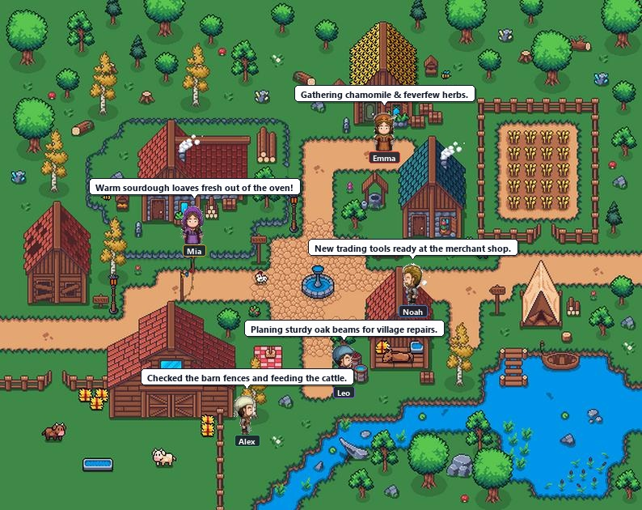
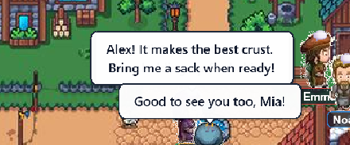
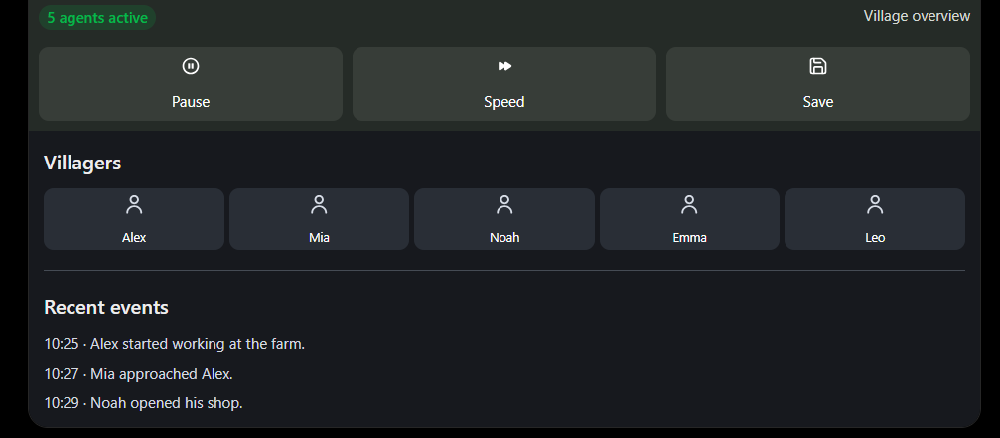
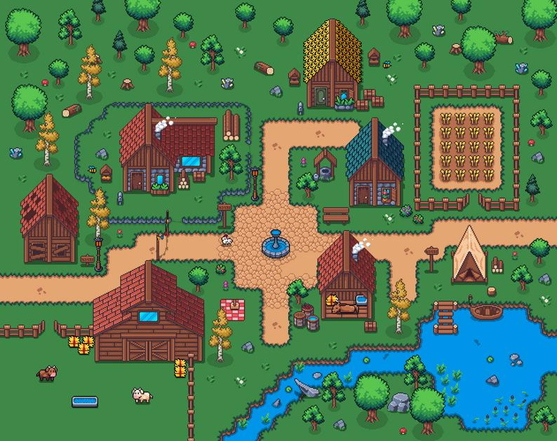
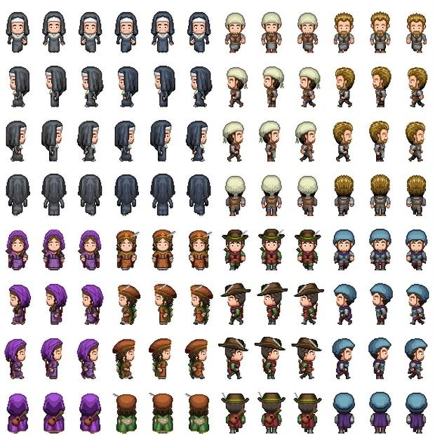
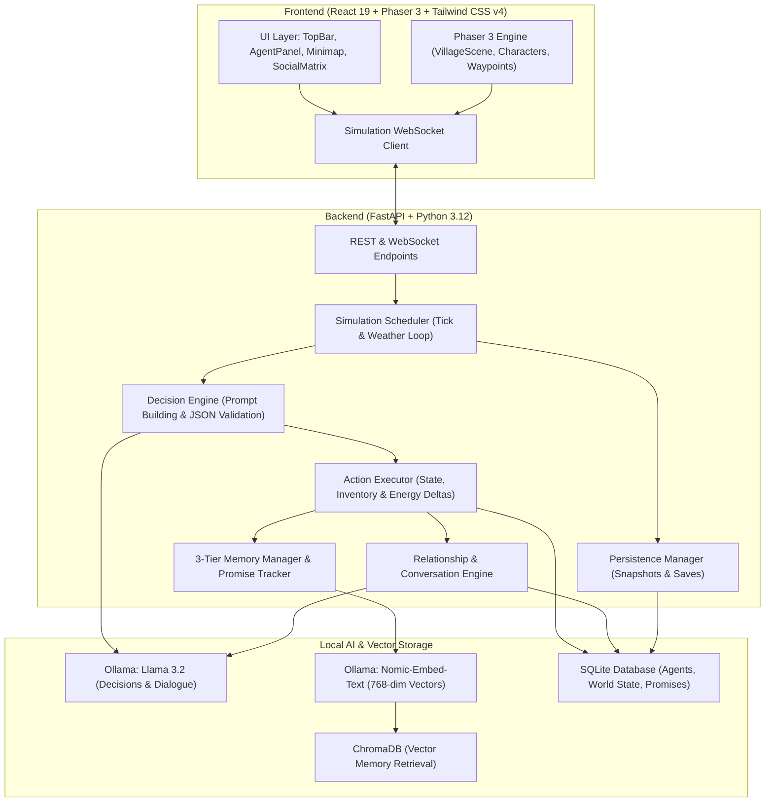

# 🏘️ Tiny Society Autonomous AI Village Simulation

<div align="center">



**Five autonomous minds. One living 2D pixel-art world. Emergent social dynamics.**

[](LICENSE)
[](https://www.python.org/)
[](https://fastapi.tiangolo.com/)
[](https://react.dev/)
[](https://phaser.io/)
[](https://ollama.com/)
[](https://www.trychroma.com/)
[](https://tailwindcss.com/)

[**Features**](#-key-features) • [**Live Gameplay & Dialogue**](#-live-gameplay--dialogue) • [**Architecture**](#-system-architecture) • [**Villagers**](#-the-5-autonomous-villagers) • [**Quick Start**](#-quick-start-guide) • [**Testing**](#-automated-testing--verification)

</div>

---

## 📖 Overview

**Tiny Society** is a real-time autonomous simulation where 5 AI agents live in an interactive, living 2D pixel-art village. Powered locally by GPU-accelerated LLM inference (**Ollama with Llama 3.2** and **Nomic Embed Text** via **ChromaDB**), characters make autonomous decisions, conduct multi-turn spoken conversations, maintain individual inventories, cultivate evolving relationships, and remember their past across simulated days.

No canned scripts — villagers choose when to work their craft, visit each other's homes or shops, chat in the town square, make promises, and react to emergent social events in real time.

---

## 🌟 Key Features

* **🧠 Autonomous AI Minds:** Five villagers with rich personalities, goals, internal tensions, and daily routines powered by local `llama3.2` with low-latency bounded inference.
* **💬 Emergent Spoken Dialogue:** Villagers hold natural in-character conversations when meeting on village paths, with floating anti-aliased speech bubbles and dialogue logs.
* **📚 3-Tier Cognitive Memory Architecture:**
  1. *Tier 1: Recency Buffer* — Fast chronological recall of immediate actions and conversations in SQLite.
  2. *Tier 2: Importance Scorer* — Heuristic evaluation scoring memories based on event severity, social impact, and high-stakes keywords.
  3. *Tier 3: Semantic Vector Search* — High-importance memories (score $\ge 0.30$) embedded with `nomic-embed-text` (768 dimensions) into a persistent ChromaDB vector store and retrieved via cosine similarity during decision cycles.
* **🤝 Spoken Promise & Commitment Tracking:** Real-time extraction of commitments made in dialogue (*"I'll bring you seasoned wood tomorrow"*), dynamic deadline tracking, and fulfillment verification.
* **❤️ Social Network & 5×5 Relationship Matrix:** Directional trust and friendship meters ($A \to B$ and $B \to A$), reciprocal adjustments, and interaction histories.
* **🗺️ Collision-Free Waypoint Navigation:** Graph-based road waypoint pathfinding with automatic stuck detection and obstacle avoidance.
* **📡 Live Radar Minimap:** Scalable 2D radar screen showing coordinates, landmarks, and real-time agent blips with instant focus navigation.
* **💾 State Snapshots & Persistence:** Complete simulation state (agents, energy, inventories, relationships, promises, time) saved to and restored from persistent JSON snapshots with automatic 30-tick background auto-saves.

---

## 📸 Live Gameplay & Dialogue

### 1. In-World Spoken Conversations
When villagers cross paths or visit each other, they naturally greet, exchange town news, trade goods, and make commitments with high-resolution floating speech bubbles:

<div align="center">



*Mia and Alex greeting each other outside the bakery and discussing grain supplies.*

</div>

### 2. Simulation Controls & Live Event Feed
Monitor all 5 villagers, adjust simulation speed (**1x / 2x / 5x**), pause/resume world time, trigger manual quicksaves, and inspect real-time village logs:

<div align="center">



</div>

---

## 🗺️ The Village World

The village is situated on a top-down pixel-art tilemap with interconnected cobblestone paths, bridges, a central plaza fountain, and specialized workplaces:

<div align="center">



</div>

### Landmarks & Workplaces
* **🌾 Alex's Farm & Barn:** Large wooden barn with cattle pasture, hay bales, and fencing.
* **🍞 Mia's Bakery & Cottage:** Cozy stone cottage with smoking chimney, herb garden, and baking oven.
* **🪙 Noah's General Store:** Blue-roof trading outpost with a fresh water well and front boardwalk.
* **🌿 Emma's Apothecary Clinic:** Thatched cottage with healing flowers and lakeside herb plots.
* **🪵 Leo's Carpentry Workshop:** Timber framing workbench with open lean-to and lumber stacks.
* **⛲ Town Square & Fountain:** Cobblestone meeting plaza where villagers gather to chat and trade.
* **🌾 Village Wheat Field:** Fenced agricultural field with rows of golden harvestable grain.
* **⛵ Lake Dock & Campsite:** Pier on the blue pond with reeds, water lilies, and traveler pavilion tent.

---

## 👥 The 5 Autonomous Villagers

Each character is rendered with customized 2D top-down sprite sheets, walking animations, direction facing, and activity icons:

<div align="center">



</div>

| Villager | Occupation | Personality | Key Goal | Core Conflict / Tension | Primary Workplace |
|---|---|---|---|---|---|
| **Alex** | Farmer 🌾 | Diligent, humble, optimistic | Grow bountiful harvests for all villagers | Anxious about erratic weather and grain shortages | Farmhouse & Wheat Field |
| **Mia** | Baker 🥖 | Warm, cheerful, talkative | Master artisan pastries and bring people together | Struggles with fluctuating ingredient supplies | Cottage & Bakery |
| **Noah** | Merchant 🛒 | Cautious, shrewd, analytical | Build a thriving, resilient trading enterprise | Torn between village generosity and profit margins | Storehouse & Shop |
| **Emma** | Healer 🌿 | Empathetic, observant, patient | Ensure wellness and discover rare remedies | Worried about villagers neglecting health for work | Apothecary & Lake Dock |
| **Leo** | Carpenter 🔨 | Creative, quiet, introspective | Construct enduring, beautiful wooden structures | Frustrated when quality craftsmanship is rushed | Quarters & Workshop |

---

## 📐 System Architecture

```
               +----------------------------------------------------+
               |       React 19 + Phaser 3 Top-Down World           |
               |  (Tilemap, Sprites, Speech Bubbles, Controls, UI)  |
               +-------------------------+--------------------------+
                                         | REST & WebSocket
                                         v
               +----------------------------------------------------+
               |              FastAPI Backend Engine                |
               |  +-------------------+      +-------------------+  |
               |  |  Tick Scheduler   | ---> |  Decision Engine  |  |
               |  +-------------------+      +-------------------+  |
               |            |                          |            |
               |            v                          v            |
               |  +-------------------+      +-------------------+  |
               |  |  Action Executor  |      | Memory & Promises |  |
               |  +-------------------+      +-------------------+  |
               +------------+--------------------------+------------+
                            |                          |
             +--------------v--------------+           v
             |     Local LLM Inference     |    +---------------+
             |  Ollama: Llama 3.2 (Model)  |    | Vector Store  |
             |  Nomic-Embed-Text (Vectors) |    |   ChromaDB    |
             +-----------------------------+    +---------------+
                            |                          |
                            +------------+-------------+
                                         |
                                         v
                            +--------------------------+
                            |     SQLite Database      |
                            | (Agents, States, Saves)  |
                            +--------------------------+
```



---

## 🚀 Quick Start Guide

### 1. Prerequisites
- **Node.js:** v18+ (tested on v20 and v24)
- **Python:** 3.10+ (tested on Python 3.12)
- **Ollama:** Installed and running locally:
  ```bash
  ollama pull llama3.2
  ollama pull nomic-embed-text
  ```

### 2. Unified One-Command Runner

Launch the full stack (FastAPI backend + Vite React/Phaser frontend) with unified logs:

```bash
# Option A: Python Runner (Cross-platform)
python run.py

# Option B: Windows Batch
run.bat

# Option C: PowerShell
.\run.ps1
```

Once running, access:
* **Frontend Application:** [http://localhost:5173](http://localhost:5173)
* **Backend API Documentation (Swagger):** [http://localhost:8000/docs](http://localhost:8000/docs)
* **WebSocket Stream:** `ws://localhost:8000/ws/simulation`

---

### 3. Manual Step-by-Step Setup

#### Backend Setup
```bash
cd backend
python -m venv venv

# Windows
.\venv\Scripts\activate

# macOS / Linux
source venv/bin/activate

pip install -r requirements.txt
uvicorn app.main:app --reload --port 8000
```

#### Frontend Setup
```bash
cd frontend
npm install
npm run dev
```

---

## 🧪 Automated Testing & Verification

The project includes an end-to-end automated test suite built with `pytest` and `pytest-asyncio` covering all simulation logic, decisions, memory scoring, vector retrieval, and persistence.

```bash
cd backend
.\venv\Scripts\activate
pytest backend/tests -v
```

### Test Suite Coverage (40 Automated Tests):
* **`test_action_executor.py`:** Work action yields (food, coins, wood), rest recovery, and movement energy expenditure.
* **`test_api_endpoints.py`:** Full REST API verification, agent details, promise retrieval, manual movement commands, and live Ollama agent chat.
* **`test_decisions.py`:** Low-energy safety overrides, JSON extraction/sanitization, contextual fallbacks, anti-loop rules, and prompt construction.
* **`test_memory_chroma.py`:** Importance scoring formula, social interaction multipliers, high-impact keyword scoring, and vector bounds.
* **`test_promises.py`:** Regex and semantic promise detection in spoken dialogue, deadline calculation, and promise fulfillment.
* **`test_persistence.py`:** Full simulation state snapshots, save/load state verification, and clean reset to Day 1 Morning defaults.

---

## 🎮 Controls & Interface Guide

| Control | Action |
|---|---|
| **Drag & Pan** | Left-click and drag anywhere on the village map to pan the camera. |
| **Mouse Wheel Zoom** | Scroll wheel to smoothly zoom between 0.75x and 2.5x. |
| **Inspect Villager** | Click on any character sprite or their top-bar avatar to open their live inspector panel. |
| **Speak to Agent** | Intervene directly by typing into the "Speak to Agent" prompt in the inspector panel. |
| **Command Movement** | Select an agent and right-click any village landmark to command them to walk there. |
| **Social Matrix** | Click **🌐 Relationships** in the top bar to inspect directional trust/friendship meters. |
| **Radar Minimap** | Interactive minimap in the bottom-left; click any blip to center the camera on that villager. |
| **Quicksave / Load** | Click **💾 Save** to record a snapshot; click **📂 Load** to restore the previous state. |
| **Simulation Speed** | Toggle between **1x**, **2x**, and **5x** simulation ticks. |

---

## 🛠️ Project Structure

```
AI Society/
├── docs/                         # Documentation images and screenshots
│   └── images/
│       ├── simulation_gameplay.jpg   # Live village simulation screenshot
│       ├── dialogue_speech_bubbles.png# In-game floating speech bubbles
│       ├── ui_controls.png           # Top bar & controls
│       ├── architecture.png          # High-level architecture diagram
│       ├── character_sprites.png     # Villager sprite sheet
│       └── village_map.png           # 794x630 pixel-art village map
│
├── frontend/                     # React 19 + TypeScript + Phaser 3 + Tailwind CSS v4
│   ├── public/assets/            # Village map & character sprite assets
│   └── src/
│       ├── components/
│       │   ├── AgentPanel.tsx    # Villager inspector, stats & memory viewer
│       │   ├── Minimap.tsx       # Live radar screen with landmark icons & blips
│       │   ├── RelationshipPanel.tsx # 5x5 social network affinity matrix
│       │   ├── TopBar.tsx        # World clock, weather, quicksave & speed controls
│       │   ├── EventLog.tsx      # Categorized real-time event feed
│       │   └── VillageGame.tsx   # Phaser container & React bridge
│       ├── game/
│       │   ├── Character.ts      # Animated sprite character with speech bubbles
│       │   ├── MovementSystem.ts # Collision-aware navigation & waypoints
│       │   ├── VillageLocations.ts # Landmarks, waypoints & obstacle definitions
│       │   └── scenes/           # VillageScene and Boot loader
│       └── services/             # Axios API client & WebSocket singleton
│
├── backend/                      # FastAPI + SQLAlchemy + ChromaDB + Ollama
│   ├── app/
│   │   ├── agents/               # DecisionEngine & personality profiles
│   │   ├── api/                  # REST & WebSocket routes
│   │   ├── database/             # SQLAlchemy models, SQLite session & repository
│   │   ├── memory/               # ImportanceScorer, PromiseTracker, ChromaService
│   │   ├── simulation/           # Scheduler, ActionExecutor, PersistenceManager
│   │   ├── social/               # ConversationEngine & RelationshipManager
│   │   └── llm/                  # Async Ollama client & prompt builders
│   ├── tests/                    # 40 automated pytest tests
│   └── requirements.txt
│
├── run.py                        # Cross-platform unified start script
├── run.bat                       # Windows one-click launcher
├── run.ps1                       # PowerShell launcher
└── README.md                     # Project documentation
```

---

## 📄 License

This project is licensed under the MIT License.
